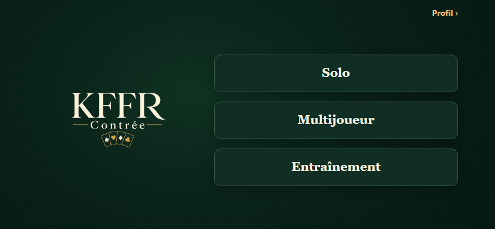
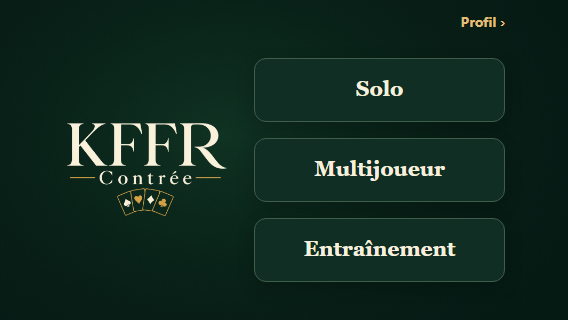

# Accueil minimal — PR #147

Cette mise à jour de la [PR existante](https://github.com/AntoninKFFR/Contree-KFFR/pull/147)
simplifie uniquement l’accueil par rapport à la révision `8899b6e`.

- Logo KFFR existant déplacé dans la composition principale ; aucun changement du fichier image.
- Trois blocs avec uniquement **Solo**, **Multijoueur**, **Entraînement**.
- Suppression du bloc décoratif, des cartes, des titres, sous-titres et badges orange.
- Header sans titre ni logo, avec le lien discret **Profil** en haut à droite.
- Barre inférieure **supprimée de l’accueil et du profil**. L’accès « Profil › » depuis
  l’accueil et le retour « ‹ Accueil » depuis le profil sont conservés. Les routes
  protégées, la gestion des comptes et le navigateur restent en place.
- Modes toujours désactivés : l’indisponibilité est annoncée à VoiceOver, sans texte secondaire visible.

La marge basse est appliquée à l’accueil **et au profil** ainsi qu’aux états
d’attente/erreur : chaque écran protège le Home Indicator sans barre inférieure. Aucun changement du contrôleur Auth, du stockage, de Supabase, de la
configuration paysage, du SDK 57, des dépendances ou du profil.

## Captures du code réel

React Native Web dans Chromium, session et pseudo de test. Ces captures ne sont pas
une validation matérielle iPhone. Insets simulés : 47 px de chaque côté, 21 px en bas.

844 × 390 :

568 × 320 :

[667 × 375](home-667.png) · [932 × 430](home-932.png) · [grand texte ×1,6](home-large-text-568.png)
· [Dynamic Island à gauche](home-island-59.png) · [Dynamic Island à droite](home-island-0.png).

La capture Profil 844 × 390 issue de cette exécution est **identique, octet pour octet**
à `docs/visual-146/after-profile-844.png` de `8899b6e` (comparaison SHA-256).
Dans le correctif final, `profile.tsx` réserve uniquement l’inset inférieur ;
le composant `GameNavigation.tsx` est retiré et l’écran de connexion reste inchangé.
Les anciennes captures Profil montrent la navigation de la révision précédente ;
un contrôle de rendu du profil sans barre est requis pour les nouvelles captures.

## Vérifications

`npm ci`, typecheck, lint, tests Node et navigation iOS, native:check,
`expo install --check`, Expo Doctor, export iOS, `git diff --check`.
`test:geometry` compte **41 tests** : les contrôles antérieurs sont conservés et
adaptés au nouveau contrat de navigation ; un cas couvre les safe areas des deux côtés,
la rotation et les états d’authentification de l’accueil sans barre.

Les tests vérifient explicitement l’absence de logo dans le header, sa présence dans
le contenu, l’absence de barre, les seuls textes visibles attendus, les trois modes
désactivés, l’aller-retour Profil et les invariants de session. Les assertions de contraste,
44 pt, absence de scroll/clipping et protection des données restent actives.
Les résultats CI sur le commit livré sont consignés dans la PR, qui reste en **draft**.

L’utilisateur confirme avoir validé l’accueil actuel sur iPhone physique.
Après retrait de la barre du profil, revérifier spécifiquement son safe area basse,
l’aller-retour Profil/Accueil et les deux paysages sur l’appareil.
Le fallback de rotation Expo Go reste inchangé.
