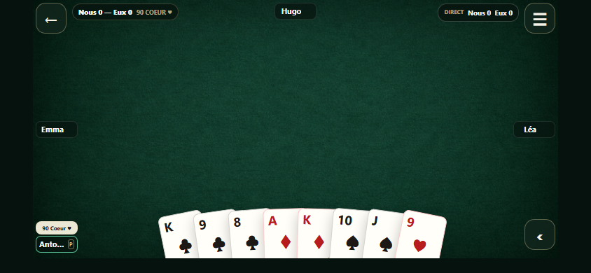
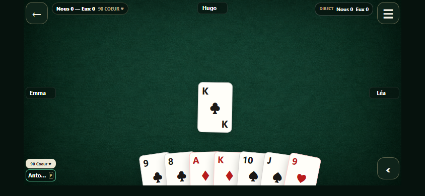
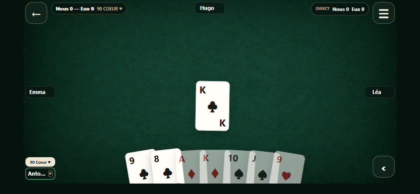

# Réactivité Solo — PR #150

## Audit

La QA physique a validé la table et le jeu, puis signalé une attente à la pose.
Les anciens logs iPhone mesuraient **593–1 625 ms par `fetch`**. Ils incluent le
transport, le traitement distant et la remise de la réponse au JS ; ils ne
permettent pas d'attribuer cette durée à Expo Go ou au seul réseau.

Chaîne native vérifiée dans `hand.tsx`, `controller.ts`, `api.ts`,
`useSolo.ts`, `presentation.ts` et `scene.tsx` :

1. Le press-in relève la carte ; le press-out valide l'intention et appelle
   directement le contrôleur. Aucun debounce ou timer avant le POST humain.
2. Le verrou synchrone empêche les doubles envois. Le POST HTTPS va directement
   vers l'API KFFR ; le tunnel Metro sert le JS et les assets, pas ce POST.
3. Attente des en-têtes, lecture du corps, JSON et validation du schéma public.
   Le serveur vérifie l'identité, lit la session possédée, calcule UNE action et
   appelle le commit versionné. Pas de données suffisantes pour mesurer ces
   sous-étapes distantes séparément : aucun `Server-Timing` exploité ici.
4. L'état validé et la fin du busy sont publiés ensemble. Deux notifications
   contrôleur par pose réussie (début/confirmation), contre quatre auparavant.
5. La carte de la main part visuellement au centre dès l'envoi : transition
   Reanimated de **180 ms**, transform uniquement, sans spinner ni liseré ni
   voile. L'état, les règles, la main et le pli autoritaires restent inchangés.
   Confirmation : remplacement au même emplacement, sans seconde animation.
   Refus : retour de **160 ms** ; réseau ambigu : retour et resynchronisation
   obligatoire. Double tap, changement de compte, arrière-plan et navigation
   conservent leurs protections. Reduce Motion / animations désactivées enlèvent
   le déplacement animé. Aucun résultat de bot n'est prédit.

## Vitesses et bots

Préférences **locales à chaque appareil**, même schéma mais pas de synchronisation
avec le `localStorage` du navigateur. Le défaut est Lent, sans changement ici.
Le preset réellement chargé apparaît dans les diagnostics de développement.

| Preset | Bot carte | Enchère | Affichage/ramassage pli |
| --- | ---: | ---: | ---: |
| slow | 1 200 ms | 800 ms | 1 800 ms |
| normal | 700 ms | 500 ms | 1 200 ms |
| fast | 300 ms | 250 ms | 650 ms |
| instant | 0 ms | 0 ms | 0 ms |

Les durées personnalisées et le ramassage manuel sont conservés. Le helper
partagé `soloBotPacing.ts` attend le **maximum** du délai bot et de la collecte
requise, sans additionner ces deux attentes. La collecte visuelle inclut la
durée de pose ; aucune attente supplémentaire de 240 ms n'est ajoutée au timer.
La file des plis garde un calque séparé pour le pli suivant et ne rejoue pas les
plis chargés lors d'une reprise. L'ultime carte humaine forcée conserve son délai.

Deux attentes inutiles corrigées et reproduites avec les vrais hooks natifs :

- Une requête humaine pendant l'affichage du pli annulait le timer, puis lui
  redonnait sa durée entière après réponse. La collecte dépend maintenant de
  la visibilité de la table, indépendamment du busy HTTP. Avec le preset slow,
  le pli est retiré à 1 800 ms même si le POST suivant reste en attente ; à
  1 900 ms l'ancien code gardait encore ce pli.
- Changer une préférence purement visuelle redémarrait les 1 200 ms du bot.
  Le pacer dépend maintenant du délai et de la clé de collecte. Changer le
  tapis à mi-attente conserve l'échéance initiale ; l'ancien code la repoussait.

Les deux tests de régression ont été exécutés avec les anciennes dépendances
de scheduling : **deux échecs attendus**, puis passent avec le correctif.
Les sélecteurs de présentation, de légalité et de tri sont mémorisés pendant
les mises à jour d'envoi : aucune transition de moteur ajoutée au bundle natif.

Le web anonyme utilise le moteur local et n'attend pas de HTTP. Le web connecté
(`useSoloGameLoop.ts` + `sessionApi.ts`) sérialise délai puis POST `advance-bot`.
Le natif faisait la même chose. Après validation physique de la nouvelle pose,
le propriétaire demande maintenant d'accélérer les bots : le natif envoie le
POST du **bot dont le tour est déjà confirmé** en parallèle de son délai visuel.
Seule la réponse publique validée est conservée en attente ; sa publication
attend à la fois HTTP, délai choisi et collecte requise. Aucun bot suivant n'est
sollicité avant publication de cette réponse. Aucun moteur/décision local,
aucune carte inventée, aucun changement d'API. Le choix de vitesse est figé au
début du tour ; une modification s'applique au suivant sans redémarrer ce tour.

Le serveur peut donc avoir déjà enregistré cette unique action pendant que son
animation attend : quitter/mettre en arrière-plan ne peut pas annuler une
mutation déjà commise. La réponse en attente est invalidée sur perte de compte,
focus ou arrière-plan ; la reprise relit le dernier état serveur. Changer
l'orientation libère la présentation en cours, sans programmer de nouveau bot
dans l'écran portrait. Les chargements et créations publient maintenant leur
état prêt atomiquement pour qu'aucun tour ne démarre dans un busy intermédiaire.
`instant` retire les timers, **pas le HTTP**.

Mesure supplémentaire avec les vrais hooks/contrôleur/API natifs et horloge
Jest contrôlée : trois tours bots consécutifs, réponse retardée de 1 000 ms,
quatre presets, avant (effet séquentiel du commit `6a5af6a`) puis après.

| Preset | Un tour avant | Un tour après | Trois tours avant → après |
| --- | ---: | ---: | ---: |
| slow | 2 200 ms | 1 200 ms | 6 600 → 3 600 ms |
| normal | 1 700 ms | 1 000 ms | 5 100 → 3 000 ms |
| fast | 1 300 ms | 1 000 ms | 3 900 → 3 000 ms |
| instant | 1 000 ms | 1 000 ms | 3 000 → 3 000 ms |

Ce sont des échéances réellement observées dans les tests natifs à temps simulé,
pas un benchmark de CPU, de réseau réel ou de FPS iPhone. Le total additionne les
trois intervalles de présentation ; il exclut les pauses de flush du runner.
Reproduction sans changer la branche ni le serveur Expo :

```sh
node scripts/benchmark-solo-bots.mjs
```

Le script charge temporairement l'ancien écran uniquement dans Jest, contrôle
les mêmes quatre scénarios, nettoie sa copie puis mesure le code actuel.
Le transport web peut réessayer certains échecs ; le natif ne rejoue jamais
automatiquement une mutation ambiguë. Ce comportement de sécurité est conservé.

## Mesures avant/après reproductibles

Référence : `1e2f924`, avant toute modification produit de ce chantier.
Même scène RN Web, vrai Reanimated, hooks, contrôleur, validation API ; seules
les réponses réseau sont des fixtures publiques. Chromium, 844×390, cinq
rechargements par délai imposé, clic DOM pour éviter l'auto-scroll de Playwright
sur la main coupée. Pas de réseau de production ni de compte réel dans ce test.
Réduction des mouvements active pour isoler le délai de réaction ; les deux
tests de trajectoire utilisent ensuite les animations réelles activées.

Les valeurs brutes et phases de la version corrigée sont dans
[`latency-measures.json`](latency-measures.json). Commande de reproduction :

| HTTP imposé | Carte au centre avant, médiane | Carte au centre après, médiane | Confirmation après, médiane |
| --- | ---: | ---: | ---: |
| 600 ms | 617,8 ms | 10,5 ms | 621,7 ms |
| 1 600 ms | 1 614,2 ms | 10,5 ms | 1 619,8 ms |

Dans ces séries, départ HTTP en médiane 0,3 ms après l'intention ; en-têtes →
corps 0,3 ms, corps → validation 0,4 ms, validation → état 0,1–0,2 ms,
état → effet React 9,3–10,5 ms, effet → RAF 8,6–10,1 ms. Ces médianes de
sous-étapes ne doivent pas être additionnées pour fabriquer un percentile.

```sh
npm run test:geometry -- --grep "Solo latency|Solo provisional"
```

Ces chiffres isolent la pose centrale, mouvements réduits : l'ancien code
relevait déjà légèrement la carte dans la main pendant l'attente. La mesure est
la première frame contenant la carte provisoire au centre (ou la carte
confirmée sur l'ancien code), pas une estimation de FPS. La confirmation est
la première frame contenant la carte du pli autoritaire. Le délai HTTP imposé
reste identique avant/après : aucun gain serveur n'est revendiqué.

Les captures réelles de cette scène, avec données de test, montrent la main
avant toucher, la pose avant réponse et la confirmation :





## Diagnostics de développement

`[Solo performance]` : numéro de trace local, type d'opération, phase et temps
depuis l'intention (`http-start`, `headers`, `body`, `validated`, `state`,
`presentation-ready`, `commit`, `frame`, `failure`). Les différences entre phases isolent les coûts
client ; `headers − http-start` inclut transport **et serveur**. Pour un bot,
`validated → state` peut inclure la fin du délai volontaire ou la collecte ;
`presentation-ready` marque leur libération, pas du travail CPU de validation. `commit` est
un effet React, `frame` un prochain RAF : ce ne sont pas des mesures de pixels
effectivement peints par le GPU iOS.

`[Solo wait]` : attente planifiée et écoulée, bot ou collecte. L'attente bot peut
inclure la barrière de ramassage, elle ne doit pas être additionnée aveuglément
au log collection. `[Solo preferences]` : preset, trois délais, Reduce Motion.
Tous ces logs sont gardés par `__DEV__` ; silence vérifié hors développement.
Aucune URL, identité, jeton, carte, main, payload ou ID de partie n'est logué.

## Évolution serveur proposée uniquement

Pour réduire fortement l'attente des trois bots connectés : une opération
versionnée/idempotente pourrait faire avancer **sur le serveur** les tours bots
consécutifs jusqu'au prochain humain ou résultat, avec une borne de trois
actions et un arrêt strict à toute décision humaine. Réponse : séquence des
vues publiques autorisées et versions intermédiaires, jamais les mains adverses.
Le natif consommerait cette séquence en conservant les délais du joueur, les
barrières de collecte et les protections de reprise/compte/conflit de version.
La version finale durable permettrait une reprise après interruption.

À valider avant implémentation : atomicité/CAS, nonce durable et rejeu sans double
action, progression/XP une seule fois, autorisation à chaque opération, bornes
de calcul et de payload, arrêt aux enchères/fin de manche, reprise d'une file
interrompue, tests de concurrence web/iOS. Pas de pré-calcul client des bots.
Trois échanges deviendraient un : économie potentielle de deux transports/auth/
lectures, **pas** de deux calculs de bot. Appliquer mécaniquement les anciens
593–1 625 ms donnerait 1,19–3,25 s économisées, mais ce n'est qu'une projection
haute : ces mesures incluent du travail qui resterait nécessaire dans le batch.
Un benchmark serveur sera indispensable. Aucun endpoint, migration, déploiement
ou réglage de production n'a été modifié dans ce correctif.

## Limites de validation

Le propriétaire a maintenant validé la pose immédiate sur iPhone (« excellent »),
puis demandé les bots plus rapides. Ce dernier chevauchement reste à ressentir
sur son appareil. Ces
mesures sont des expériences RN Web contrôlées, pas une mesure avant/après sur
l'iPhone 15. Expo Go en développement et l'export Hermes ne prouvent pas les FPS
d'un binaire de release. Le premier téléchargement des gros assets via tunnel
peut rester lent ; le cache/préchauffage existant est conservé. Accueil, Profil,
Supabase, assets et SDK 57 restent inchangés dans ce correctif.

Référence SDK vérifiée : [Reanimated dans Expo SDK 57](https://docs.expo.dev/versions/v57.0.0/sdk/reanimated/).
Skills utilisés sur ce correctif : `expo-overview`, `expo-animation`,
`expo-data-fetching`, revue `react-best-practices`.
Installation recontrôlée : plugin officiel Expo 1.0.2 configuré, 26 skills
Expo/EAS présents et disponibles ; aucune réinstallation ou session supplémentaire.
