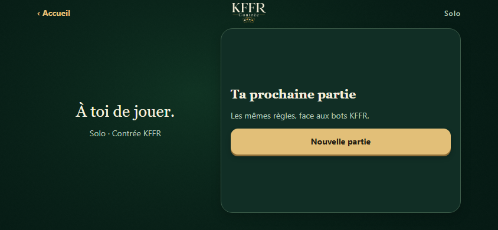
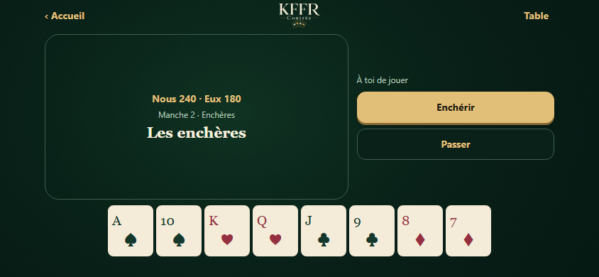
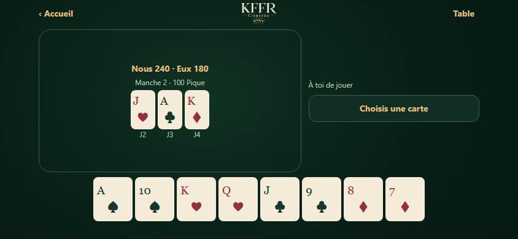
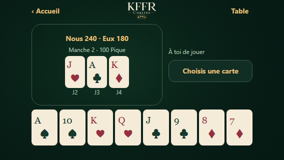
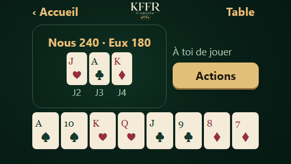
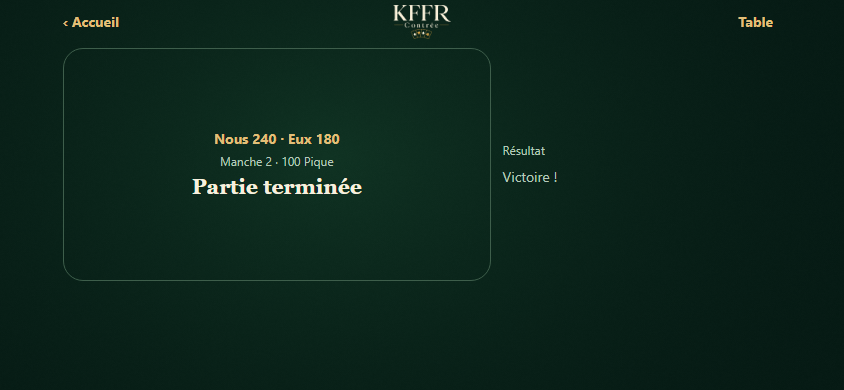
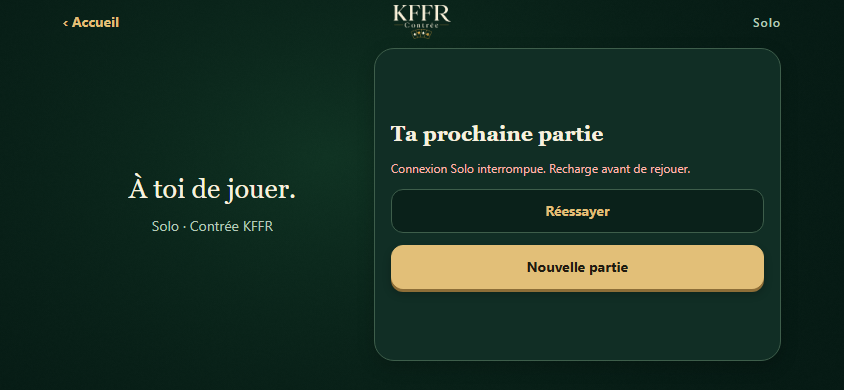

# Solo natif — captures du code réel

Vrais composants React Native de `src/app/(connected)/solo.tsx`, affichés dans
Chromium via React Native Web. Session, sauvegarde et réponses HTTP sont des
fixtures de test ; aucun compte, jeton ou jeu de production n’est utilisé.
Ces captures ne constituent pas une validation matérielle iPhone.

## Accès et enchères

## Main et pli public

## Résultat et erreur

Reproduction : `npm run test:geometry`. Le banc Vite utilise des réponses fixtures
uniquement dans `tests/visual/solo-environment.ts`, via un alias de test absent de
Metro. Scénarios : `?screen=solo&solo=empty`, `bidding`, `playing`, `trick`,
`finished`, `game-over`, `offline`, `loading` ou `action-error`. « Reprendre »
reste nécessaire pour afficher une partie sauvegardée et déclencher le jeu.

Architecture, fonctionnalités et limites : [SOLO.md](../../SOLO.md).
