# KFFR — direction artistique iOS, issue #146

**Version actuelle de l’accueil : [accueil minimal de la PR #147](../home-minimal-147/README.md).**
Les captures de ce dossier conservent la première passe de comparaison artistique.

Première passe complète « Club Émeraude », [issue #146](https://github.com/AntoninKFFR/Contree-KFFR/issues/146).
Base : `main` à `41c81000b136f2ecce517219e66748c218656ca1` (PR #145 fusionnée).
Les images sont des captures Chromium des **vrais composants React Native via React Native Web**.
Le banc fournit une session de test et le pseudo fictif `Antonin KFFR`, sans contacter Supabase.
Ce ne sont ni des maquettes générées ni des preuves de rendu natif sur iPhone.

## Deux propositions, même contenu et même format

| Critère | A — Club Émeraude, retenue | B — Salon Ivoire |
| --- | --- | --- |
| Composition | Signature à gauche, trois entrées de jeu à droite | Trois cartes claires, symétriques |
| Matière | Feutrine sombre éclairée, ivoire et doré en accents | Papier ivoire dominant, contours dorés |
| Identité | Éventail original, serif éditoriale, menu de club | Cartes signalétiques inspirées de l’Art déco |
| Paysage compact | Art réduit et menu hiérarchisé à 568 px | Titres plus serrés sur trois colonnes |
| Suite du produit | Table et chrome discrets réutilisables pour le jeu | Surface claire plus dominante pendant le jeu |

**Choix A :** davantage d’immersion et une meilleure hiérarchie sur les petits paysages.
Les futurs modes restent désactivés, sans faux bouton « Jouer » ni partie simulée.
B demeure un prototype dans `tests/visual/proposals`, hors graphe Metro iOS.

A — 844 × 390 :

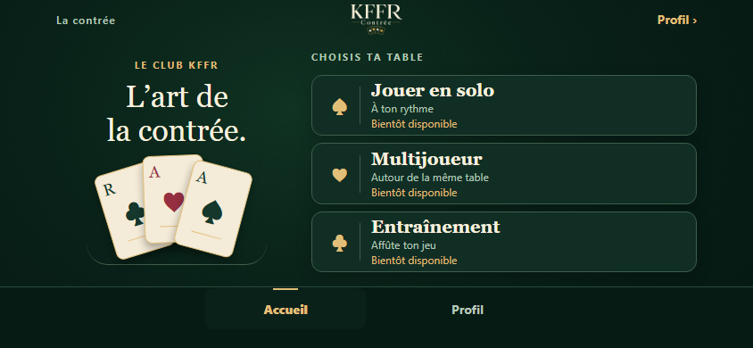

B — 844 × 390 :

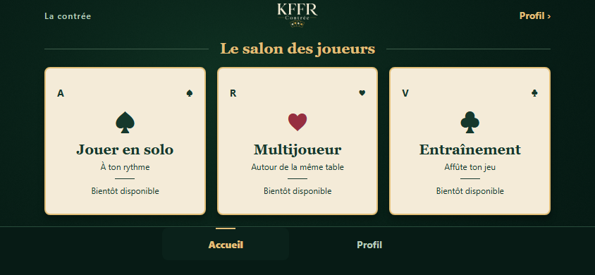

Même comparaison à 568 × 320 :


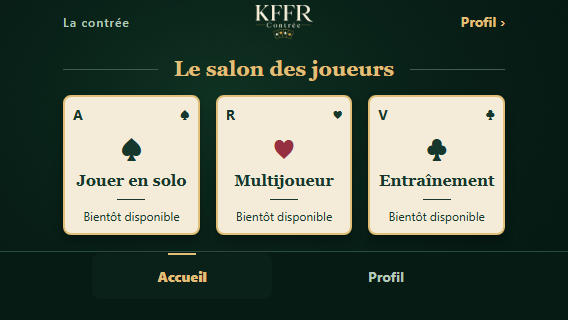

## Avant / après

Les captures avant viennent de `main`, prises avant toute modification de l’interface.
Marges simulées identiques : 47 px de chaque côté et 21 px en bas.

| Écran, 844 × 390 | Avant | Après |
| --- | --- | --- |
| Accueil | 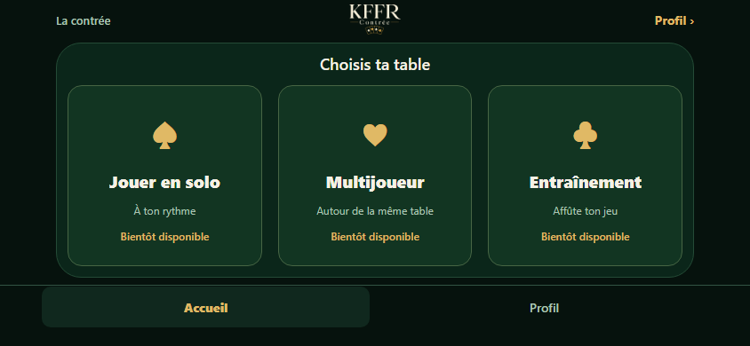 |  |
| Profil | 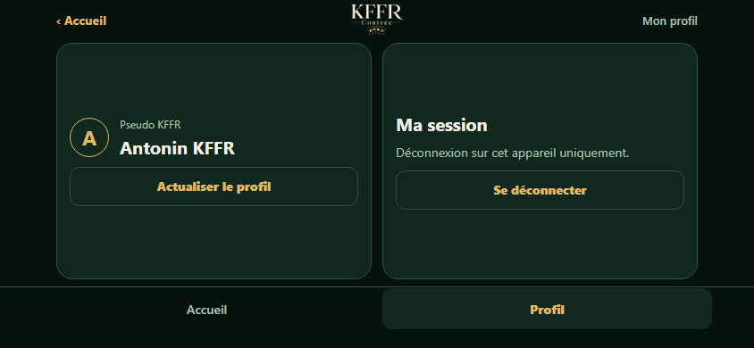 | 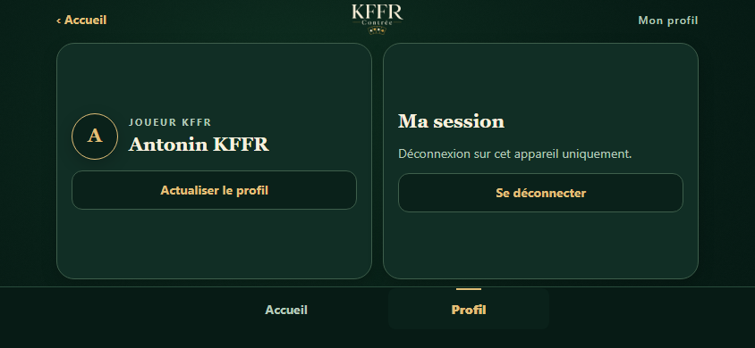 |
| Connexion | 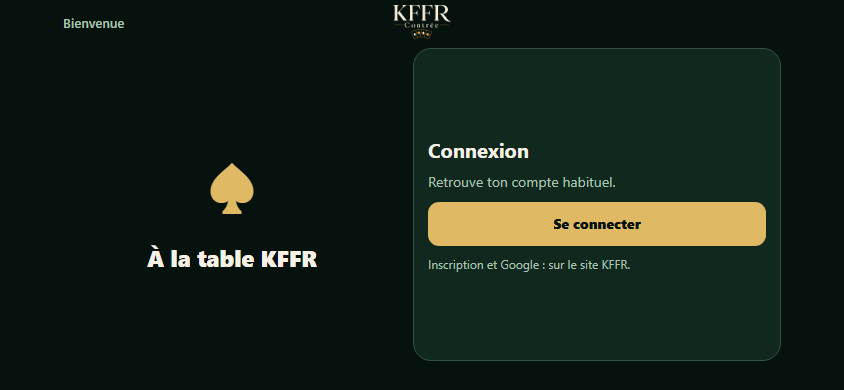 | 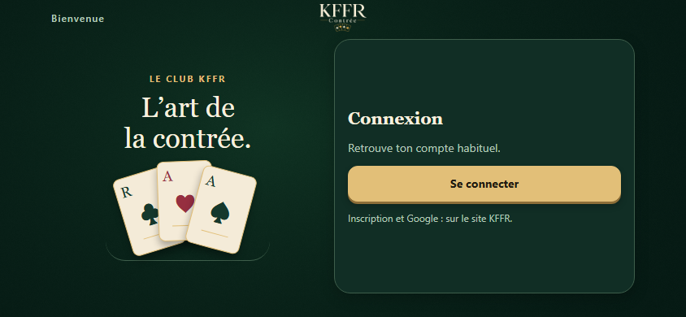 |

À 568 × 320 :

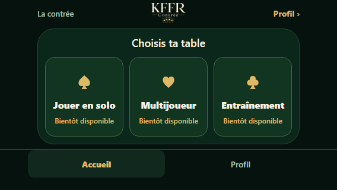
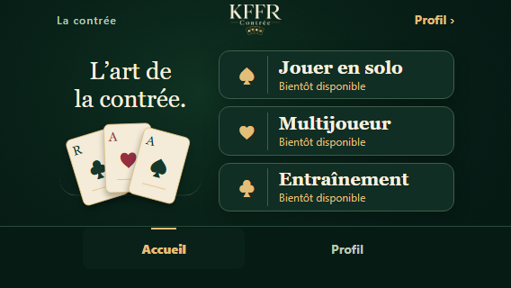

Grand texte ×1,6, sans décor superflu ni texte tronqué :

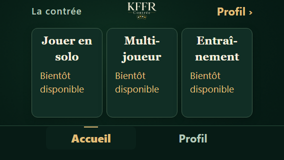

États du vrai bouton et du formulaire :

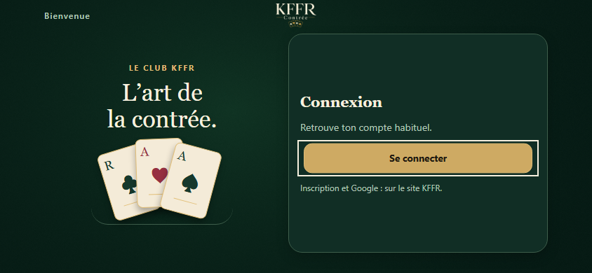
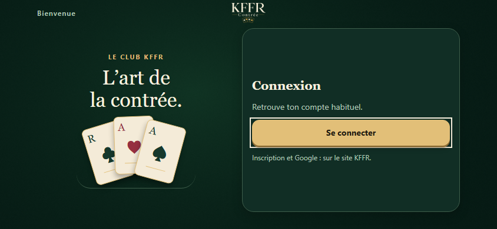
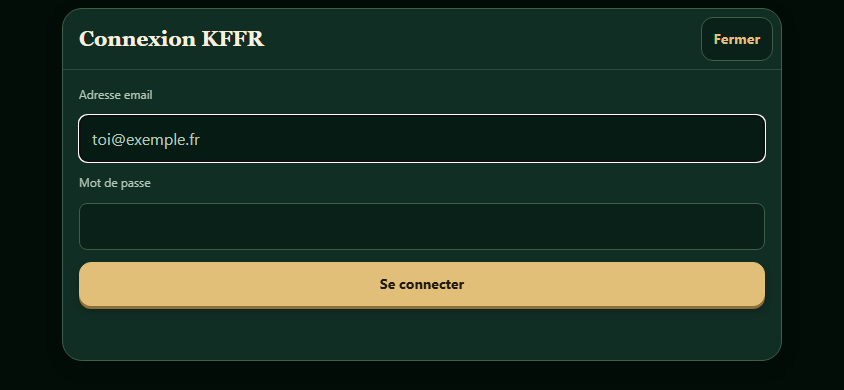

Le test à 200 px de hauteur simule la place perdue par le clavier, sans reproduire UIKit :

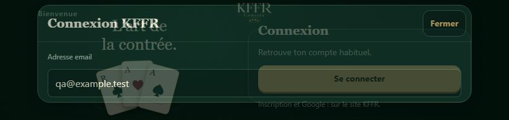

## Réalisation

- Palette unique dans `src/theme/tokens.ts` : feutrine, surfaces en retrait/relief,
  ivoire, encre de carte, rouge cœur et or ; typo, espacements, rayons, ombres et motion.
- Texture originale déterministe `assets/felt-table.png`, reproductible avec
  `node scripts/create-table-art.mjs` : grain, lumière et vignette. Aucun asset tiers ajouté.
- Cartes décoratives en vues/textes natifs, masquées à VoiceOver ; seuls ces dessins
  ne suivent pas Dynamic Type. Les textes d’interface restent redimensionnables.
- `TableBackdrop` et `ClubSignature` partagés ; boutons, formulaire et profil cohérents.
- Bouton principal à tranche dorée, secondaires en retrait, pression colorée,
  désactivation lisible, champs actifs bordés d’or et focus clavier conservé.
- Vraie transition Reanimated 4 existant : pression à 0,97 en 120 ms, relâchement
  rapide. La cible tactile ne rétrécit pas. Pas de cascade ou boucle décorative.
- Reduce Motion suivi en direct : pas de réduction d’échelle, transition à 0 ms,
  modal sans fondu ; le changement de couleur reste immédiat.
- Barre à 48 pt plus **un seul** inset bas ; logo 80 × 34 centré ; onglets immédiats
  et sélection dorée. Aucune nouvelle dépendance UI, WebView ou police téléchargée.

Les recommandations génériques de tabs/header système sont adaptées à la contrainte
du jeu : le chrome compact déjà validé reste en place. Le modal de connexion garde
son `KeyboardAvoidingView` et son scroll secondaire. Contrôleur de session, client
Supabase, stockage et configuration native inchangés. Le pseudo reste volontairement
masqué pendant sa revérification, sans cache d’une identité non vérifiée.

## Outils Expo réellement installés

Installation le 18 octobre 2026, d’après la [documentation officielle](https://docs.expo.dev/skills/).

1. `codex plugin add expo@openai-curated` : succès. **Expo 1.0.2**, auteur Expo Team,
   dans `~/.codex/plugins/cache/openai-curated/expo/0722921d`, activé dans
   `~/.codex/config.toml`. Manifeste et fichiers lus. Ce paquet utilise encore les
   anciens noms (`building-native-ui`, etc.).
2. Complément officiel pour les noms actuels vérifiés dans `expo/skills` :

   ```sh
   npx --yes skills@latest add expo/skills --skill '*' --agent codex --global --yes
   ```

   **26 skills copiés** dans `~/.agents/skills` ;
   `npx --yes skills@latest list --global --agent codex` les retrouve avec
   `Agents: Codex`, `Source: expo/skills`. Les `SKILL.md` utilisés ont été lus.
3. Le catalogue de la session ouverte et `codex plugin list` n’ont pas immédiatement
   reflété le plugin. Les fichiers sont installés et utilisables directement.
   Si les sélecteurs ne se rafraîchissent pas, redémarrer Codex suffit ; aucune
   réinstallation manuelle nécessaire. [Découverte locale](https://developers.openai.com/codex/skills/).

Inventaire des 26 skills :

```text
eas-app-stores       eas-hosting             eas-observe
eas-simulator        eas-update              eas-update-insights
eas-workflows        expo-animation          expo-app-clip
expo-brownfield      expo-data-fetching      expo-design-system
expo-dev-client      expo-dom                expo-examples
expo-migrate-module  expo-module             expo-native-ui
expo-overview        expo-project-structure  expo-router
expo-skill-eval      expo-skill-feedback     expo-ui
expo-upgrade         expo-web-to-native
```

| Skill consulté | Usage |
| --- | --- |
| `expo-native-ui` | Hiérarchie, ombres natives, safe areas, tailles et accessibilité |
| `expo-design-system` | Extension des tokens existants, composants communs et cohérence |
| `expo-animation` | Pression brève Reanimated, fréquence et Reduce Motion |
| `expo-router` | Revue des onglets, routes protégées, modales et tests ; structure conservée |
| `expo-ui` | Pertinence/compatibilité évaluées : pas de picker ou réglages SwiftUI nécessaire, donc pas de dépendance `@expo/ui` ajoutée |

OpenAI Docs, Plugin Management et Skill Installer ont servi à l’installation ; React
Best Practices à la revue des hooks, nettoyages, états et composants TSX. Lire un skill
ne signifie pas ajouter un module natif portant son nom.

## Références et droits

L’identité et le logo KFFR existants restent la source de marque. Les références
[Coinche d’Eryod Soft](https://play.google.com/store/apps/details?id=com.eryodsoft.android.cards.coinche.lite)
et [Belote.com](https://play.google.com/store/apps/details?id=com.gameduell.mobile.belote)
servent au cadrage ergonomique : priorité à la table, choix du mode, commandes compactes.
Aucun code, carte, texture ou illustration de ces jeux n’est intégré. Le site belote.com
a refusé la lecture automatique (403) ; sa fiche publique a été consultée.

## Reproduire les preuves

Depuis `apps/mobile`, `npm run test:geometry` démarre Vite et exécute **40 tests**.
Les 37 contrôles antérieurs restent présents ; trois cas ajoutent les deux DA à deux
tailles et les états réels de pression/Reduce Motion/focus. Les rapports complets
restent dans `geometry-results` et `geometry-report`, avec traces en cas d’échec.
Les captures sélectionnées ici sont versionnées, sans identifiant utilisateur.

Pour explorer : `npx vite --config tests/visual/vite.config.ts`, puis
`http://127.0.0.1:8091/?proposal=club` ou `?proposal=salon` ; profil `?screen=profile`,
connexion `?screen=login`, grand texte `?font=1.6`, réseau `?screen=profile&state=offline`.
Ce banc local n’est pas une version web de production.

## Validation et limites

Contrôles locaux : `npm ci` racine/mobile ; typecheck, lint, tests dans les deux projets ;
build Next ; geometry ; native:check ; Expo install --check ; Doctor ; export iOS ;
`git diff --check`. Les résultats détaillés et la CI sont consignés dans la PR draft.
Aucun achat, build signé, publication ou changement de production.

La dette de dépendances et AsyncStorage non chiffré restent documentés dans
[SECURITY.md](../../SECURITY.md) : 64 paquets signalés côté mobile et 25 côté web
à l’installation, lockfiles inchangés, aucun `audit fix --force`. Les contrôles verts
ne constituent pas un audit de sécurité.

**QA iPhone à refaire pour cette DA** (les retours antérieurs ne la valident pas) :

- iPhone 15 / iOS 27.0.1 / Expo Go SDK 57 : deux sens paysage, Dynamic Island,
  retour du portrait, Accueil/Profil sans scroll ni élément coupé.
- Clavier iOS, focus email/mot de passe, touche « go », fermeture/réouverture ; vrai
  compte, pseudo, actualisation, persistance et déconnexion.
- Texte augmenté, VoiceOver (décor ignoré, modes annoncés indisponibles), Réduire
  les animations modifié en cours d’exécution, fluidité des pressions.
- Le fallback « Tourne ton iPhone » reste si Expo Go conserve une fenêtre portrait.
  Le lancement permanent sera prouvé par le binaire dédié, toujours non compilé/signé
  ici : [NATIVE-IOS.md](../../NATIVE-IOS.md).
